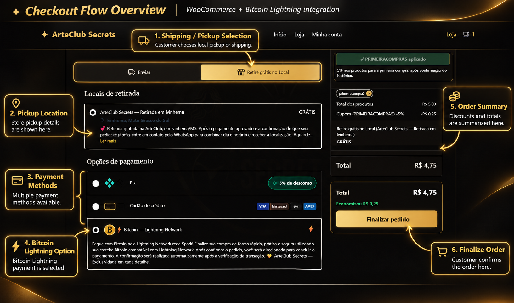
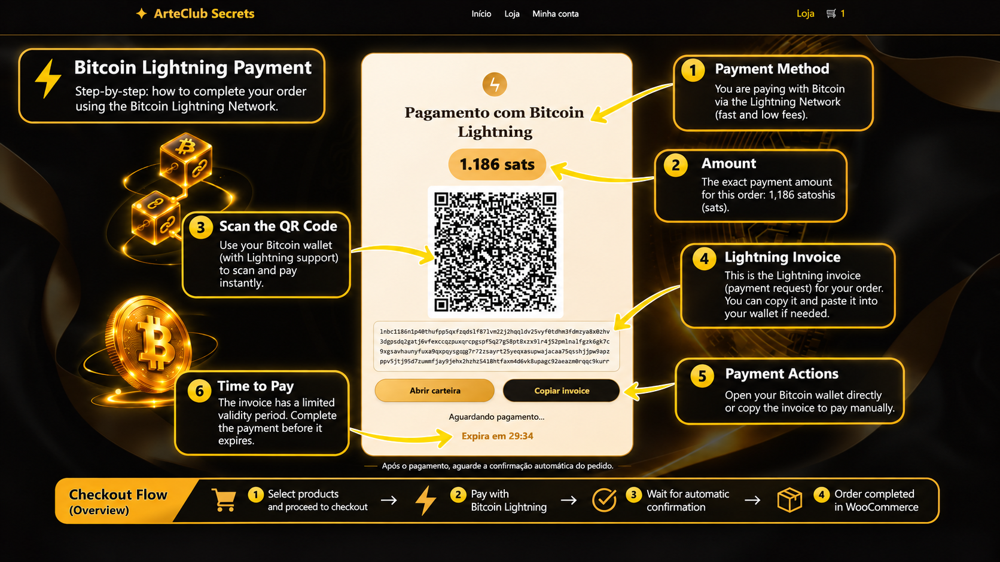
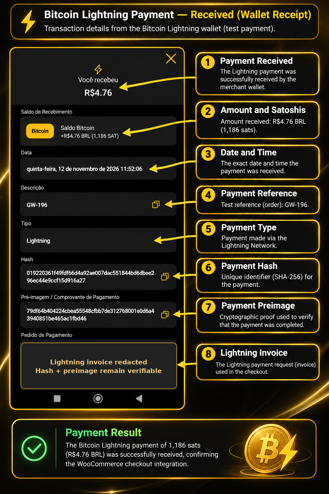
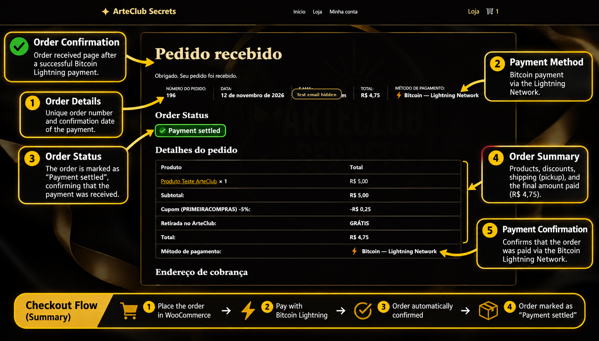
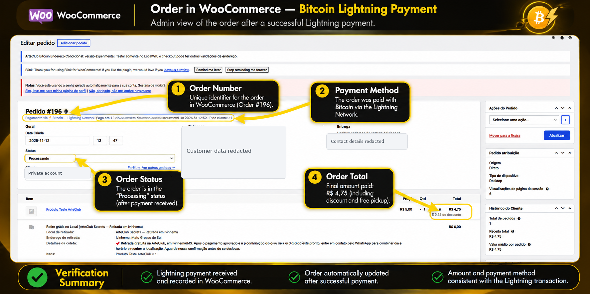
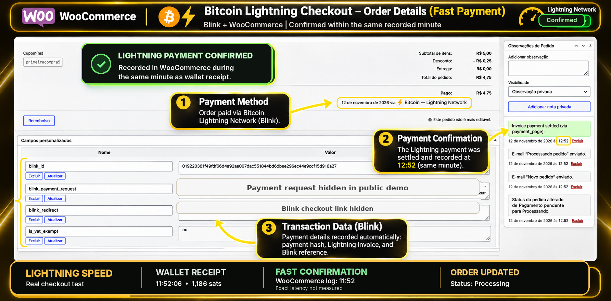

<p align="center">
  
</p>

# ₿ Bitcoin Lightning Checkout for WooCommerce

**Bitcoin Payments via Lightning Network | WooCommerce | Blink Integration**

A practical e-commerce payment integration project demonstrating Bitcoin payments via the Lightning Network using WooCommerce and Blink.

Developed and tested as part of a customized online store, with a focus on payment experience, automation, and usability.

---

## Project Overview

This project demonstrates the integration and customization of a Bitcoin Lightning payment experience within WooCommerce.

The checkout allows customers to select a Bitcoin payment method, receive a Lightning payment request, and complete their purchase through a compatible wallet.

### Key Features

- Bitcoin payment option integrated with WooCommerce.
- Lightning Network payment requests and QR code presentation.
- Integration with Blink's payment infrastructure.
- Automated WooCommerce order status updates following successful payment confirmation.
- Responsive checkout experience.

## Testing

The Lightning checkout flow has been tested in the development environment, including payment processing through Blink and automated WooCommerce order confirmation.

This demonstration does not represent an independent security audit or a certification for production use.


## Bitcoin Lightning Payment Flow — Real Test

A step-by-step visual demonstration of a successful Bitcoin Lightning payment integrated with WooCommerce.

The screenshots are based on a real payment test performed on November 12, 2026.

### 1. Bitcoin Checkout — Payment Selection

Customers can select Bitcoin Lightning as a payment method directly in the WooCommerce checkout.



### 2. Lightning Invoice — QR Code & Payment Request

The checkout generates a Lightning invoice displaying the payment amount in satoshis, QR code, wallet options, and expiration timer.



### 3. Lightning Payment — Merchant Wallet Receipt

The merchant wallet confirms receipt of 1,186 sats, corresponding to the WooCommerce test transaction.



### 4. WooCommerce — Order Confirmation

After payment confirmation, the WooCommerce order page displays the payment as settled.



### 5. WooCommerce Admin — Order Processing

The administration panel records the successful Bitcoin Lightning payment and updates the order status to Processing.



### 6. Lightning Payment — Automatic Settlement

The WooCommerce order notes and payment metadata demonstrate automatic settlement recording.

The payment and order updates occurred within the same recorded minute. The exact processing latency was not independently measured.



### Demonstration Notes

- Real Bitcoin Lightning payment test.
- Test order: #196.
- Amount received: 1,186 sats.
- Payment infrastructure: Blink.
- Platform: WordPress and WooCommerce.
- Screenshots include English explanatory annotations and selected redactions.
- Cryptographic payment verification is documented in the following section.

---


## Verified Lightning Payment — Real Test

### Successful Bitcoin Lightning Payment

A real Bitcoin Lightning Network payment was successfully completed during a WooCommerce checkout test on November 12, 2026.

**Payment Information**

| Field | Value |
|---|---|
| Network | Bitcoin Lightning Network |
| Amount | 1,186 sats |
| Merchant receipt | R$ 4.76 BRL |
| WooCommerce test order | #196 |
| Payment reference | GW-196 |
| Date | November 12, 2026 |
| Merchant receipt status | Received |
| WooCommerce order status | Payment settled |

### Cryptographic Proof of Payment

The following payment preimage and payment hash were obtained from the merchant's Lightning payment receipt.

**Payment Hash**

```text
019220361f49fdf66d4a92ae007dac551844bd6dbee296ec44e9ccf15d916a27
```

**Payment Preimage**

```text
79df64b404224cbea55548cfbb7de312768001e0d6a43940851be465ac1fbd46
```

### Independent Verification

Anyone can verify the cryptographic relationship by calculating the SHA-256 hash of the 32-byte payment preimage.

```python
import hashlib

preimage = "79df64b404224cbea55548cfbb7de312768001e0d6a43940851be465ac1fbd46"

result = hashlib.sha256(bytes.fromhex(preimage)).hexdigest()

print(result)
```

**Expected result:**

```text
019220361f49fdf66d4a92ae007dac551844bd6dbee296ec44e9ccf15d916a27
```

**Verification result:** SHA-256 preimage and payment hash match.

This is cryptographic evidence of the disclosed Lightning payment preimage. Together with the merchant receipt and WooCommerce screenshots, it documents the tested payment flow.

Lightning payments are not individually recorded as public on-chain transactions, so this payment cannot be looked up using a conventional Bitcoin blockchain transaction explorer.

This verification does not independently authenticate the payer, the merchant account, or the security of the entire checkout implementation.

---

## Technologies

- WordPress
- WooCommerce
- PHP
- Bitcoin / Lightning Network
- Blink
- AI-assisted development tools

## My Contribution

**Denis Dorneles — Dorneles Digital Solutions**

My work on this project includes:

- Planning checkout functionality and requirements.
- AI-assisted implementation and customization.
- Testing payment flows and customer experience.
- Identifying issues and guiding corrections.
- Reviewing integrations and WooCommerce order behavior.

The underlying Bitcoin payment infrastructure is provided by Blink; this project focuses on its WooCommerce integration and customization.

## Screenshots & Demonstration

Screenshots and demonstrations of the tested checkout will be added to this repository.

## Source Code

This repository is a public portfolio case study. The underlying commercial integration code and private configuration are not included.

## Contact

**Denis Dorneles**  
Dorneles Digital Solutions  
Web Development | AI & Bitcoin Solutions

Email: dorneles.dev@proton.me

GitHub: https://github.com/denisdorneles

---

*Portfolio project — Dorneles Digital Solutions*  
*By Denis Dorneles*
